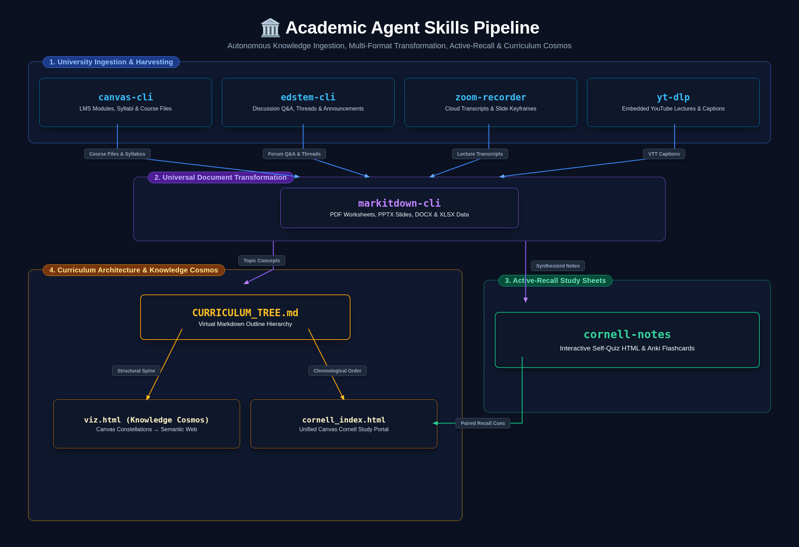
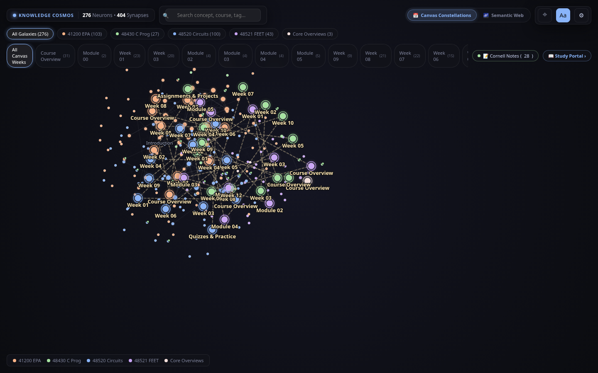

# Academic Agent Skills (`academic-agent-skills`)

[](https://github.com/rodritimecoder/academic-agent-skills)
[](https://www.python.org/)
[](LICENSE)

> **University & Academic Knowledge Mining Toolkit for AI Agents** (Claude Code, Pi, Antigravity, Gemini).  
> Turn syllabus modules, cloud lecture recordings, research papers, YouTube videos, and raw document dumps into clean, structured Markdown study guides and Cornell revision sheets.

---

## 🏛️ Architecture: The Complete University-to-Markdown Pipeline

<p align="center">
  
</p>

<details>
<summary><b>Click to view ASCII Architecture Diagram</b></summary>

```
  ┌────────────────────────────────────────────────────────────────────────┐
  │                 University Data Ingestion & Harvesting                 │
  └───────────────────────────────────┬────────────────────────────────────┘
                                      │
     ┌──────────────────┬─────────────┴────────────┬──────────────────┐
     ▼                  ▼                          ▼                  ▼
┌──────────────┐ ┌──────────────┐          ┌──────────────┐    ┌──────────────┐
│  canvas-cli  │ │  edstem-cli  │          │zoom-recorder │    │    yt-dlp    │
│ LMS modules, │ │ Forum Q&A,   │          │Cloud lecture │    │ YouTube head │
│ assignments, │ │ threads, and │          │transcripts,  │    │ teacher/lab  │
│ course files │ │ announcements│          │passcodes     │    │ videos       │
└──────┬───────┘ └──────┬───────┘          └──────┬───────┘    └──────┬───────┘
       │                │                         │                   │
       └────────────────┴────────────┬────────────┴───────────────────┘
                                     │
                                     ▼
        ┌──────────────────────────────────────────────────────────────┐
        │              Universal Document Transformation               │
        │                        markitdown-cli                        │
        │           PDFs, PPTX slides, DOCX, XLSX, HTML, Zip           │
        └────────────────────────────┬─────────────────────────────────┘
                                     │
                                     ▼
        ┌──────────────────────────────────────────────────────────────┐
        │               Active-Recall & Revision Output                │
        │                        cornell-notes                         │
        │          Interactive self-quiz HTML & Anki cards             │
        └────────────────────────────┬─────────────────────────────────┘
                                     │
                                     ▼
        ┌──────────────────────────────────────────────────────────────┐
        │            Curriculum Architecture & Cosmos Graph            │
        │                        okf-architect                         │
        │         • CURRICULUM_TREE.md Virtual Outline Tree            │
        │         • Dual-Mode Knowledge Cosmos (viz.html)              │
        │           [Canvas Constellations ⟷ Semantic Web]             │
        │         • Unified Canvas Cornell Study Portal                │
        │         • OKF v0.2 Specification Certification               │
        └──────────────────────────────────────────────────────────────┘
```

</details>

---

## ⚡ Quickstart for Claude / AI Agents

When handing this repository or individual skills to an agent (Claude Code, Pi, Antigravity):

### 1. Clone the Repository
```bash
git clone https://github.com/rodritimecoder/academic-agent-skills.git
cd academic-agent-skills
```

### 2. Prerequisites & Essential Tooling
Agents should ensure `yt-dlp` and `markitdown` are installed on the system:

```bash
# 1. Install yt-dlp (audio/video transcript ingestion for YouTube & web lectures)
pip install -U yt-dlp
# Or on macOS: brew install yt-dlp
# Or standalone binary: curl -L https://github.com/yt-dlp/yt-dlp/releases/latest/download/yt-dlp -o ~/.local/bin/yt-dlp && chmod +x ~/.local/bin/yt-dlp

# 2. Install MarkItDown & HTTP requests
pip install 'markitdown[all]' requests
```

---

## 📦 Academic Skills Inventory

| Skill | Category | Primary Function | Setup Required |
|---|---|---|---|
| [`canvas-cli`](canvas-cli/) | LMS Harvester | Enrolled courses, assignments, syllabus, modules, files | Canvas API token in `canvas-cli/.env` |
| [`edstem-cli`](edstem-cli/) | Discussion & Forum Q&A | Forum threads, announcements, questions, classmate/tutor answers | Ed token in `edstem-cli/.env` |
| [`zoom-recorder`](zoom-recorder/) | Lecture Transcripts | Passcode-protected Zoom cloud transcripts (`.md`/`.vtt`) & slide keyframes | None (Zero API admin keys required) |
| [`markitdown-cli`](markitdown-cli/) | Document Parser | Converts PPTX slide decks, PDF worksheets, DOCX, XLSX to Markdown | `pip install 'markitdown[all]'` |
| [`cornell-notes`](cornell-notes/) | Study & Revision | Formats markdown notes into interactive self-quiz Cornell HTML & Anki flashcards | Python stdlib (zero-dep) |
| [`okf-architect`](okf-architect/) | Knowledge Architecture & Cosmos | Virtual curriculum trees (`CURRICULUM_TREE.md`), dual-mode graph cosmos (`viz.html`), and Cornell study portal (`cornell_index.html`) | Python stdlib (zero-dep) |
| [`academic-icm`](academic-icm/) | Pipeline Orchestrator | Complete ICM orchestrator (`status`, `audit`, `scaffold`, `compile`, `serve`) enforcing strict stem inheritance | Python stdlib (zero-dep) |

---

## 🚀 Usage Guide

### 1. `canvas-cli` — Canvas LMS Data Harvester
Zero third-party HTTP dependencies (built on Python standard library `urllib`). Features deterministic token shields (`--table`, `--project`, `--limit`, `--format`).

**Setup**:
Copy `canvas-cli/.env.example` to `canvas-cli/.env`:
```bash
cp canvas-cli/.env.example canvas-cli/.env
```
Fill in your details:
```
CANVAS_API_KEY=your_canvas_api_token_here
CANVAS_URL=https://your-school.instructure.com
```

**Common Agent Commands**:
```bash
# List all active enrolled courses as compact Markdown table
python3 canvas-cli/scripts/canvas_cli.py courses --summary --table

# Check actionable upcoming assignments & quizzes across all courses
python3 canvas-cli/scripts/canvas_cli.py upcoming --limit 10

# Inspect modules & weekly content items for a course
python3 canvas-cli/scripts/canvas_cli.py modules <course_id> --table

# Fetch course syllabus
python3 canvas-cli/scripts/canvas_cli.py courses --course-id <course_id> --syllabus
```

---

### 2. `edstem-cli` — Ed Discussion & Course Forum Gateway
Zero third-party dependencies (Python standard library `urllib`). Slashes thread dumps from 30k tokens down to ~350 tokens (98% token reduction) with dense tables and pre-flight projection.

**Setup**:
Copy `edstem-cli/.env.example` to `edstem-cli/.env`:
```bash
cp edstem-cli/.env.example edstem-cli/.env
```
Fill in your token:
```
ED_API_TOKEN=your_ed_api_token_here
```

**Common Agent Commands**:
```bash
# List enrolled Ed courses
python3 edstem-cli/scripts/ed_cli.py courses --table

# List recent threads in a course as a compact Markdown table
python3 edstem-cli/scripts/ed_cli.py threads <course_id> --table --limit 15

# Search forum for specific assignments or questions
python3 edstem-cli/scripts/ed_cli.py search <course_id> "assignment 2" --table

# Read a thread with answers and comments in clean Markdown
python3 edstem-cli/scripts/ed_cli.py thread <thread_id> --table
```

---

### 3. `zoom-recorder` — Cloud Lecture & Tutorial Extractor
- Connects directly to university passcode-protected Zoom cloud recordings (`*.zoom.us`, `utsmeet.zoom.us`) using web playback session tokens.
- Unwraps **Microsoft SafeLinks** and **Mimecast** protection URLs automatically.
- Includes **`--outline` / `--agenda`** token shield to collapse 50k VTT transcripts down to ~200-token chronological tables.

```bash
# Extract high-density lecture agenda outline (~200 tokens)
python3 zoom-recorder/scripts/zoom_download.py \
  --url "https://utsmeet.zoom.us/rec/share/..." \
  --passcode "Passcode123" \
  --outline

# Download clean Markdown transcript from a passcode-protected Zoom lecture
python3 zoom-recorder/scripts/zoom_download.py \
  --url "https://utsmeet.zoom.us/rec/share/..." \
  --passcode "Passcode123" \
  --out-dir "./notes/transcripts" \
  --format md

# Automated Canvas crawl: extracts Zoom URLs + passcodes from course modules and downloads transcripts
python3 zoom-recorder/examples/canvas_zoom_pipeline.py \
  --course-id <course_id> \
  --out-dir "./notes/recordings" \
  --format md
```

---

### 4. `markitdown-cli` — Universal Document-to-Markdown Parser
Converts lecture slide decks (`.pptx`), tutorial worksheets (`.pdf`), lab guides (`.docx`), and spreadsheets into clean Markdown. Features AST outline extraction (`--outline` / `--toc`, ~80 tokens), section slicing (`--section`), and regex search (`--grep`):

```bash
# Inspect document heading outline without dumping 30k text into context (~80 tokens)
python3 markitdown-cli/scripts/markitdown_cli.py lecture_slides.pptx --outline

# Extract only a specific chapter or section
python3 markitdown-cli/scripts/markitdown_cli.py syllabus.pdf --section "Grading Scheme"

# Full document conversion with compact receipt
python3 markitdown-cli/scripts/markitdown_cli.py tutorial_sheet.pdf -o tutorial_notes.md --table
```

---

### 4. `yt-dlp` — Embedded Video Lecture Transcripts
When Canvas pages embed YouTube videos from professors and head teachers:
```bash
# Pull auto/manual subtitles directly without video file overhead
yt-dlp --write-auto-sub --sub-lang en --skip-download --sub-format vtt -o "lecture_video.%(ext)s" "<YOUTUBE_URL>"
```

---

### 5. `cornell-notes` — Active-Recall Revision Sheet Generator
Transforms notes into interactive, print-ready Cornell study notes HTML with cue-note pairs, summary boxes, and active-recall test blurring:

```bash
python3 cornell-notes/format_notes.py /path/to/notes_cornell.json
```

---

### 6. `okf-architect` — Curriculum Architecture & Knowledge Cosmos Engine
The unifying engine that connects raw markdown notes, slide transcripts, and Cornell study sheets into a coherent, navigable curriculum:

- **Virtual Curriculum Tree (`CURRICULUM_TREE.md`)**: Human-editable, clickable Markdown outline grouping all courses and weekly modules without breaking physical paths on disk.
- **Dual-Mode Interactive Graph (`viz.html`)**: Standalone, offline-ready D3 cosmos with live top-bar toggle:
  - **`📅 Canvas Constellations`**: Modules linked along a chronological learning spine (`Week 01 → Week 02 → ...`) with orbital containment.
  - **`🌌 Semantic Web`**: Classic Obsidian neural network gliding organically on concept cross-references.
- **Canvas Cornell Study Portal (`cornell_index.html`)**: Automatically indexes all active-recall Cornell revision notes by course and week with instant self-quiz launch buttons.
- **Open Knowledge Format (OKF v0.2) Certification**: Scaffolds, normalizes, and certifies knowledge bundles adhering to Google's OKF v0.2 specification.

<p align="center">
  
</p>

```bash
# 1. Compile or initialize CURRICULUM_TREE.md into interactive cosmos & study portal
python3 okf-architect/scripts/okf_architect.py compile-tree /path/to/notes

# 2. Re-render standalone Knowledge Cosmos (viz.html)
python3 okf-architect/scripts/okf_architect.py viz /path/to/notes

# 3. Validate entire knowledge bundle against OKF v0.2 spec
python3 okf-architect/scripts/okf_architect.py validate /path/to/notes
```

---

## 📄 License
This repository is open-sourced under the [MIT License](LICENSE).
